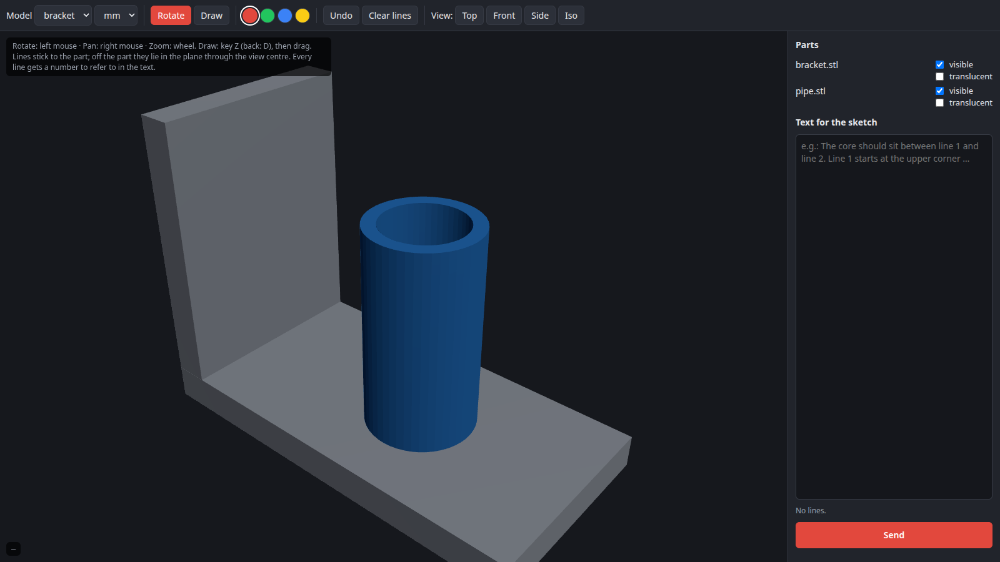

# sketch-to-prompt

**Deutsch** · [English](#english)

> Hobbyprojekt, aus Neugier entstanden. Entstanden beim Konstruieren mit einem KI-Assistenten (Claude Code) im
> Projekt [stellarator-design](https://github.com/ThomasSchmiegelt/stellarator-design).

Geometrie mit Worten zu beschreiben ist mühsam. „Dreh den Stutzen um 180°“ oder „der Kern soll schräg liegen“ lässt
sich auf mehrere Arten verstehen. Eine Skizze ist eindeutig. **sketch-to-prompt** macht aus einer Skizze am
3D-Modell eine Eingabe für eine KI:

1. Bauteil (STL) im Browser drehen.
2. Mit der Maus Linien **direkt auf das Bauteil** zeichnen. Jede Linie bekommt eine Nummer.
3. Text dazuschreiben („der Kern soll zwischen Linie 1 und Linie 2 liegen“) und **Senden** drücken.

Die KI erhält dann nicht nur ein Bild, sondern auch die **genauen 3D-Punkte jeder Linie auf dem Bauteil**. Sie muss
nicht raten, wo eine Linie beginnt und endet.



### Installation und Start

Benötigt Python ≥ 3.9 und einen Browser mit WebGL, sonst nichts. three.js wird von unpkg geladen.

```bash
git clone https://github.com/ThomasSchmiegelt/sketch-to-prompt
cd sketch-to-prompt
python3 examples/make_example.py              # kleines Beispielmodell (Winkel + Rohr)
python3 -m sketch_to_prompt.server examples   # dann http://127.0.0.1:8765 öffnen
# oder installieren: pip install . && sketch-to-prompt <ordner> [--lang en] [--out sketches]
```

**Modelle:** Jede STL-Datei im Ordner ist ein Modell. Jeder Unterordner mit STL-Dateien ist ein Modell aus
mehreren Teilen, die einzeln ein- und ausgeblendet oder durchsichtig gemacht werden können (z. B. Stahl und Wasserraum).

### Bedienung

| | |
|---|---|
| Drehen / Verschieben / Zoom | linke Maus / rechte Maus / Mausrad |
| Zeichnen | Taste `Z` oder Knopf „Zeichnen“, dann ziehen; zurück zum Drehen mit `D` |
| Rückgängig | `Strg+Z` |
| Ansichten | Oben, Vorne, Seite, Schräg |
| Koordinaten | unten links: Punkt unter der Maus (x, y, z, R, φ um die z-Achse) |

Linien haften am Bauteil und drehen mit. Neben dem Bauteil liegen sie in der Ebene durch die Bildmitte.

### Was beim Senden entsteht

Unter `sketches/<zeit>/`:
- `sketch.png`: die Ansicht mit den Linien
- `sketch.json`: Text, Kamera, sichtbare Teile, jede Linie als Bildpunkte **und** 3D-Punkte (mit getroffenem Teil)
- `prompt.md`: dasselbe als lesbarer Text für jede KI ([Beispiel](docs/example_prompt.md))

`sketches/latest.txt` nennt die neueste Skizze.

### Mit einer KI benutzen

- **Beliebiger KI-Chat:** `prompt.md` einfügen und `sketch.png` anhängen.
- **Claude Code oder andere Agenten mit Shell:** Den Agenten bitten, auf neue Skizzen zu warten, zum Beispiel:
  > Starte im Hintergrund `until [ -f sketches/latest.txt ]; do sleep 3; done; cat sketches/latest.txt` und lies
  > dann `prompt.md`, `sketch.png` und `sketch.json` aus dem genannten Ordner. Danach `latest.txt` löschen und neu warten.

  Der Agent wird so benachrichtigt, sobald du auf „Senden“ drückst.

Bewährt hat sich: Der Agent antwortet mit einem Bild des geänderten Modells **aus derselben Blickrichtung**
(Kamera steht in `sketch.json`). Dann lassen sich Skizze und Ergebnis direkt vergleichen.

### Grenzen

- Nur STL. Große Netze (> ~2 Mio. Dreiecke) sollten vorher vereinfacht werden, damit der Browser flüssig bleibt.
- Nur lokal (127.0.0.1), keine Anmeldung, keine Mehrbenutzer-Funktion.

---

## English

> Hobby project, built out of curiosity while designing with an AI assistant (Claude Code) in
> [stellarator-design](https://github.com/ThomasSchmiegelt/stellarator-design).

Describing geometry in words is hard: "rotate the nozzle by 180°" or "the core should be tilted" can be read in
several ways. A sketch is unambiguous. **sketch-to-prompt** turns a sketch on a 3D model into input for an AI:

1. Rotate a part (STL) in the browser.
2. Draw lines **directly on the part**. Every line gets a number.
3. Add text ("the core should sit between line 1 and line 2") and press **Send**.

The AI gets not just a picture but the **exact 3D points of every line on the part**, so it does not have to guess
where a line starts and ends.

### Install and run

Python ≥ 3.9 and a browser with WebGL, nothing else. three.js is loaded from unpkg.

```bash
git clone https://github.com/ThomasSchmiegelt/sketch-to-prompt
cd sketch-to-prompt
python3 examples/make_example.py
python3 -m sketch_to_prompt.server examples --lang en   # open http://127.0.0.1:8765
# or: pip install . && sketch-to-prompt <folder> [--lang en] [--out sketches]
```

**Models:** every STL file in the folder is a model. Every subfolder with STL files is a model with several parts,
which can be hidden or made translucent one by one.

### Controls

| | |
|---|---|
| Rotate / pan / zoom | left mouse / right mouse / wheel |
| Draw | key `Z` or the Draw button, then drag; back to rotating with `D` |
| Undo | `Ctrl+Z` |
| Views | Top, Front, Side, Iso |
| Coordinates | bottom left: the point under the cursor (x, y, z, R, φ about z) |

### Output

`sketches/<time>/` holds:
- `sketch.png`: the view with your lines
- `sketch.json`: text, camera, visible parts, and every line as screen points **and** 3D points, with the part each point hit
- `prompt.md`: the same as readable text for any AI ([example](docs/example_prompt.md))

`sketches/latest.txt` points to the newest sketch.

### Using it with an AI

- **Any AI chat:** paste `prompt.md` and attach `sketch.png`.
- **Claude Code or other agents with a shell:** ask the agent to wait for new sketches in the background, for example
  `until [ -f sketches/latest.txt ]; do sleep 3; done; cat sketches/latest.txt`. It then reads the three files,
  deletes `latest.txt` and waits again. The agent is notified as soon as you press Send.

It works well when the agent answers with a picture of the changed model **from the same viewpoint**; the camera is
in `sketch.json`.

### Limits

- STL only. Simplify very large meshes (> ~2 M triangles) first so the browser stays smooth.
- Local only (127.0.0.1), no login, single user.

License: MIT. three.js (MIT) is loaded at runtime from unpkg.
